<!--
  ╔══════════════════════════════════════════════════════════╗
  ║       MOHAMED HAMED // DEVELOPER PROFILE                 ║
  ║       AI • SOFTWARE ENGINEERING • SYSTEMS                ║
  ╚══════════════════════════════════════════════════════════╝
-->

<div align="center">



<br/>



<br/>

<a href="https://github.com/Mohamed-Hamed5">
  
</a>


<br/><br/>

*"Turning curiosity into code, and code into solutions."*

</div>

---

## `01 // WHO AM I?`

```python
class MohamedHamed:
    def __init__(self):
        self.role = "Computer Science Student"
        self.university = "Benha University, Egypt"
        self.interests = [
            "Artificial Intelligence",
            "Software Engineering",
            "Backend Development",
            "Problem Solving",
            "Linux & Networking"
        ]
        self.mindset = "Learn by building"
        self.current_goal = "Build meaningful projects"

    def next_step(self):
        return "Learn -> Build -> Test -> Improve"
```

Hey! I'm **Mohamed Hamed**, a fourth-year Computer Science student at Benha University, Egypt.

* 🧠 Exploring AI and Machine Learning, with a focus on practical implementation.
* 💻 Building my programming foundation through hands-on projects.
* 🌐 Learning web technologies and backend development.
* 🐧 Exploring Linux, networking, and the systems behind modern software.
* 🛠️ Interested in connecting algorithms, data, and software into useful solutions.

I believe the best way to learn technology is to build something with it.

---

## `02 // TECH ARSENAL`

### Programming Languages

<p>

</p>

### Web Development & Databases

<p>

</p>

### Tools, Systems & Design

<p>

</p>

| Area                     | Experience / Focus                           |
| ------------------------ | -------------------------------------------- |
| C++ & C                  | Programming fundamentals, problem solving    |
| Python                   | Fundamentals; building toward AI/ML          |
| Java, PHP & JavaScript   | Learning and practical development           |
| HTML, CSS & Sass         | Web development fundamentals                 |
| SQL & Databases          | Database fundamentals                        |
| R                        | Statistical computing                        |
| Linux & Git              | Command line and version control             |
| Cisco Networking         | Networking fundamentals and NetAcad learning |
| MATLAB, SPSS & Excel     | Scientific and statistical tools             |
| Figma & Microsoft Office | Design, documentation and productivity       |

---

## `03 // CURRENT MISSION`

<div align="center">

### 🧠 Project: AI & Machine Learning

**From Python fundamentals to practical intelligent systems.**

</div>

My current learning priorities:

* 📘 Strengthen Python and data handling.
* 📊 Understand NumPy, Pandas, and data preprocessing.
* 🤖 Learn Machine Learning concepts and model evaluation.
* 🧠 Explore neural networks and PyTorch.
* 🔗 Understand how AI models integrate with real software applications.

```text
DATA -> PREPROCESSING -> MODEL TRAINING -> EVALUATION -> INTEGRATION -> REAL-WORLD APPLICATION
```

My objective isn't just to run an AI model. It's to understand what it does, evaluate its results, and integrate it into a working project.

---

## `04 // PROJECTS & EXPERIMENTS`

> A growing collection of practical work, experiments, and things I'm learning.

### 🔬 Featured Work

**🏦 Banking Knowledge Graph** *(Graduation Project)*

A graph-native architecture for Egyptian banking use cases, exploring how connected data can power smarter banking solutions.

`Graph Databases` `AI` `Data Modeling`

**📦 WarehousePro AI**

A full-stack SaaS inventory management platform with an AI assistant, combining a modern web application, database operations, and AI-assisted features.

`React` `Node.js` `MySQL` `Software Engineering`

**📊 Smart Statistical Analysis System**

A statistical analysis dashboard built with R Shiny, designed to support data exploration, descriptive statistics, visualizations, and reporting.

`R` `Shiny` `Statistics` `Data Visualization`

**🌱 Second Chance**

An AI-focused project where I'm developing my understanding of how intelligent components can be designed and integrated into a larger application.

`Python` `AI/ML` `Data Processing`

<div align="center">

<a href="https://github.com/Mohamed-Hamed5?tab=repositories">
  
</a>

</div>

---

## `05 // GITHUB TELEMETRY`

<div align="center">


<br/><br/>


</div>

---

## `06 // CONTRIBUTION MATRIX`

<div align="center">

<picture>
  <source media="(prefers-color-scheme: dark)" srcset="https://raw.githubusercontent.com/Mohamed-Hamed5/Mohamed-Hamed5/output/github-contribution-grid-snake-dark.svg"/>
  <source media="(prefers-color-scheme: light)" srcset="https://raw.githubusercontent.com/Mohamed-Hamed5/Mohamed-Hamed5/output/github-contribution-grid-snake.svg"/>
  
</picture>

</div>

---

## `07 // BEYOND THE CODE`

* 🧩 Breaking complicated problems into smaller, understandable pieces.
* 🔍 Exploring how systems work under the hood.
* 📚 Learning through experimentation, debugging, and iteration.
* 🚀 Turning academic knowledge into practical software.

<div align="center">

`LEARN` → `EXPERIMENT` → `BUILD` → `DEBUG` → `REPEAT`

</div>

---

## `08 // LET'S CONNECT`

<div align="center">

<a href="https://github.com/Mohamed-Hamed5">
  
</a>
<a href="mailto:mohammadhamed5359@gmail.com">
  
</a>

<br/><br/>

**Interested in software, AI, collaboration, and meaningful technical challenges.**

<br/>


<sub>Designed with curiosity. Powered by persistence. Built one commit at a time.</sub>

</div>
